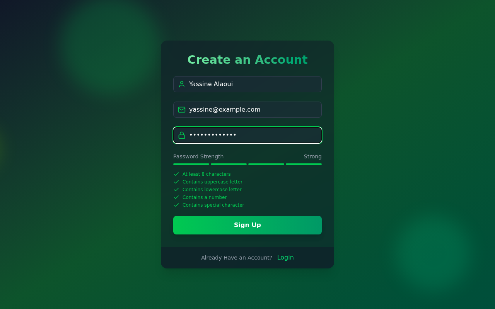
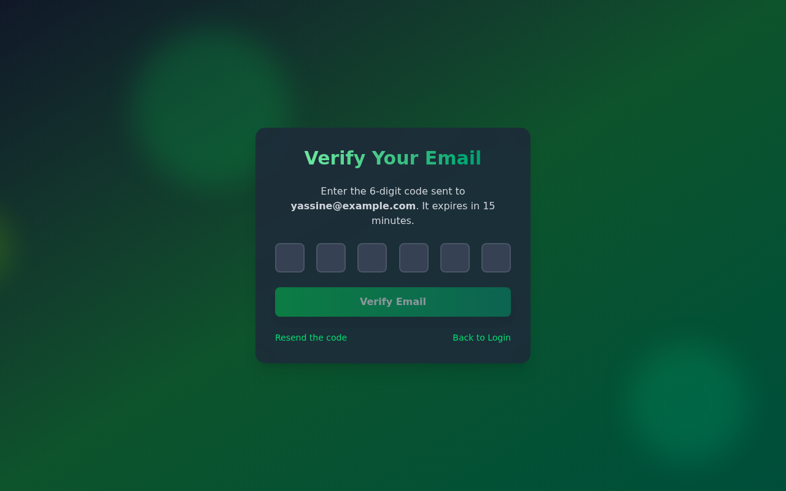
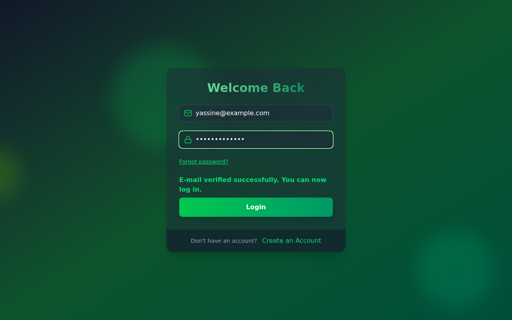
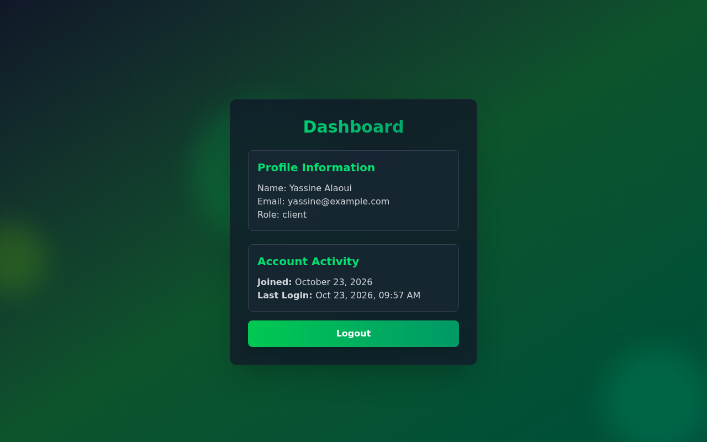
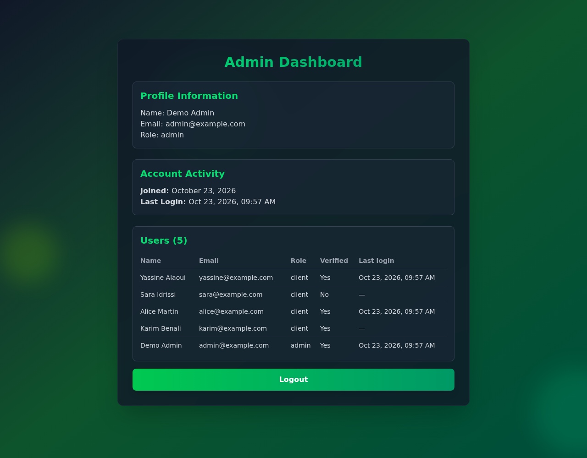

# MERN JWT Authentication

[](https://github.com/blcoussama/MERN-JWT-AUTHENTICATION/actions/workflows/ci.yml)

Authentification complète pour une application MERN : inscription avec code de vérification envoyé par e-mail, connexion par JWT dans des cookies httpOnly, refresh token renouvelé à chaque usage, mot de passe oublié et rôles `client` / `admin` contrôlés côté serveur.

| Inscription | Vérification de l'e-mail | Connexion |
|---|---|---|
|  |  |  |

| Tableau de bord client | Tableau de bord admin (liste des comptes) |
|---|---|
|  |  |

*Captures réalisées en local avec `npm run dev:demo` (base MongoDB en mémoire, données fictives).*

## Fonctionnalités

- **Inscription** (nom, e-mail, mot de passe) : un code à 6 chiffres est envoyé par e-mail, valable 15 minutes. Bouton « Resend the code » (un envoi par minute au maximum).
- **Vérification de l'e-mail** : le code est lié à l'adresse, 5 essais au maximum. La vérification n'ouvre pas de session : l'utilisateur se connecte ensuite avec son mot de passe.
- **Connexion / déconnexion** : jeton d'accès (15 min) et refresh token (7 jours) dans des cookies `httpOnly`, `SameSite=Strict`, `Secure` en production. La date de dernière connexion est enregistrée.
- **Session** : le front renouvelle la session tout seul lorsque le jeton d'accès expire (intercepteur Axios, une seule requête de refresh à la fois).
- **Mot de passe oublié** : lien de réinitialisation valable 1 heure et utilisable une seule fois ; la réinitialisation déconnecte tous les appareils.
- **Rôles** : chaque compte créé est `client`. Le rôle `admin` ne s'obtient qu'en ligne de commande sur le serveur (`npm run admin:promote`). L'admin voit la liste des comptes (`GET /api/users`, rôle vérifié par l'API et relu en base à chaque requête).

## Stack

- **Backend** : Node.js 24, Express 5, MongoDB / Mongoose 9, jsonwebtoken, bcryptjs, zod, helmet, express-rate-limit, SendGrid
- **Frontend** : React 19, Redux Toolkit, React Router 7, Axios, Tailwind CSS 4, Framer Motion, Vite 8
- **Tests** : Vitest, Supertest, mongodb-memory-server
- **CI** : GitHub Actions (lint, tests, build, `npm audit`)

## Architecture

```
backend/
  app.js                  createApp({ config, mailer }) : application Express (testable)
  index.js                démarrage : configuration validée, MongoDB, transport e-mail
  config/env.js           lecture et validation des variables d'environnement (zod)
  controllers/            authController (inscription, vérification, login, refresh, reset), userController (liste admin)
  services/sessionService.js   JWT, cookies, rotation des refresh tokens et détection de rejeu
  middlewares/            VerifyToken, authorizedRoles, validate (zod), rate limiters, gestion d'erreurs
  models/                 User, RefreshToken (une famille de jetons par connexion, purge automatique par index TTL)
  mails/                  modèles d'e-mails + transports SendGrid / console (dev) / mémoire (tests)
  scripts/                demo.js (démo sans installation), promoteAdmin.js
  tests/                  tests Supertest
frontend/                 application React (Vite) ; /api est relayé vers le backend en développement
```

En production, Express sert aussi le build du front : front et API partagent la même origine, sans CORS, ce qui permet `SameSite=Strict`.

## Lancer le projet en local

Prérequis : Node.js 22.12 ou plus récent (CI en Node 24).

### Démo en une commande (sans MongoDB ni SendGrid)

```bash
npm install && npm install --prefix frontend
npm run dev:demo                 # terminal 1 : API sur http://localhost:3000
npm run dev --prefix frontend    # terminal 2 : front sur http://localhost:5173
```

`dev:demo` démarre une base MongoDB **en mémoire** (mongodb-memory-server ; le binaire est téléchargé au premier lancement), génère des secrets aléatoires et affiche les e-mails dans le terminal (codes de vérification, liens de réinitialisation). Un compte admin vérifié est créé et son mot de passe aléatoire est affiché au démarrage. Les données disparaissent à l'arrêt.

### Avec une vraie base MongoDB

```bash
docker run -d --name mern-auth-mongo -p 27017:27017 mongo:8   # ou une base MongoDB Atlas
cp .env.example .env    # puis remplir les variables (voir ci-dessous)
npm run dev                      # API (rechargement automatique avec node --watch)
npm run dev --prefix frontend    # front
```

Donner le rôle admin à un compte déjà vérifié :

```bash
npm run admin:promote -- user@example.com
```

### Production

```bash
npm run build   # installe les dépendances et construit le front
npm start       # NODE_ENV=production : sert l'API et le front sur le même port
```

En production, le transport e-mail `console` est refusé : SendGrid (clé API + expéditeur vérifié) est obligatoire. Derrière un reverse proxy (Render, Heroku, Nginx…), définir `TRUST_PROXY=1` pour que le rate limiting utilise l'IP du client.

## Variables d'environnement

Fichier `.env` à la racine (jamais versionné). La configuration est validée au démarrage : l'application refuse de démarrer si une variable est absente ou invalide.

| Variable | Obligatoire | Description |
|---|---|---|
| `NODE_ENV` | non | `development` (défaut) ou `production` |
| `PORT` | non | Port de l'API (défaut `3000`) |
| `MONGO_URI` | oui | Chaîne de connexion MongoDB |
| `JWT_SECRET` | oui | Secret des jetons d'accès, 32 caractères minimum |
| `REFRESH_SECRET` | oui | Secret des refresh tokens, 32 caractères minimum, différent de `JWT_SECRET` |
| `CLIENT_URL` | non | URL du front utilisée dans les e-mails (défaut `http://localhost:5173`) |
| `MAIL_TRANSPORT` | non | `console` (défaut en dev) ou `sendgrid` (défaut et obligatoire en production) |
| `SENDGRID_API_KEY` | avec SendGrid | Clé API SendGrid |
| `EMAIL_FROM` | avec SendGrid | Adresse d'expédition vérifiée dans SendGrid |
| `EMAIL_FROM_NAME` | non | Nom de l'expéditeur (défaut `MERN JWT Auth`) |
| `TRUST_PROXY` | non | Nombre de proxys de confiance (défaut `0`) |

Générer un secret : `node -e "console.log(require('crypto').randomBytes(48).toString('hex'))"`

## API

| Méthode | Route | Accès | Rôle |
|---|---|---|---|
| POST | `/api/auth/signup` | public | Crée un compte `client` en attente et envoie un code |
| POST | `/api/auth/resend-verification` | public | Renvoie un code (1 par minute) |
| POST | `/api/auth/verify-email` | public | `{ email, code }` : vérifie l'adresse |
| POST | `/api/auth/login` | public | Ouvre une session (cookies) |
| POST | `/api/auth/refresh-token` | cookie refresh | Renouvelle les deux jetons (rotation) |
| POST | `/api/auth/logout` | public | Révoque la session et efface les cookies |
| POST | `/api/auth/forgot-password` | public | Envoie un lien de réinitialisation |
| POST | `/api/auth/reset-password/:token` | public | Change le mot de passe |
| GET | `/api/auth/check-auth` | connecté | Utilisateur courant |
| GET | `/api/users?page=1` | admin | Liste paginée des comptes |

Les réponses ne contiennent jamais de jeton, de code, de hash ni de mot de passe.

## Tests

```bash
npm test          # 45 tests Supertest sur une base MongoDB en mémoire (aucune installation requise)
npm run lint      # ESLint backend
npm run lint --prefix frontend && npm run build --prefix frontend
```

Les tests couvrent les parcours (inscription, vérification, connexion, refresh, logout, reset) et des **tests d'attaque** : injection NoSQL `{"code":{"$ne":null}}`, code d'un autre compte, 6ᵉ essai après 5 échecs (y compris 20 essais envoyés en parallèle), inscription avec `role: "admin"`, recherche de secrets dans les réponses JSON, rejeu d'un ancien refresh token, jetons forgés ou `alg: none`, rate limiting, énumération de comptes, accès admin refusé à un client et perdu dès la rétrogradation en base, en-têtes de sécurité.

## Sécurité en place

- **Validation stricte** (zod) de chaque corps de requête : clés inconnues et valeurs non textuelles refusées ; `mongoose.set('sanitizeFilter', true)` en défense supplémentaire contre l'injection d'opérateurs.
- **Code de vérification** : `crypto.randomInt`, stocké sous forme de HMAC, lié à l'e-mail, expiration 15 min, 5 essais comptés de façon atomique, renvoi limité. Deviner un code ne donne pas accès au compte (connexion par mot de passe ensuite).
- **Jetons** : HS256 imposé à la vérification, rôle relu en base à chaque requête, refresh token à usage unique stocké haché (SHA-256), détection de rejeu qui révoque toute la famille de la session volée, révocation au logout et à la réinitialisation du mot de passe.
- **Cookies** `httpOnly`, `SameSite=Strict`, `Secure` en production ; le refresh token n'est envoyé qu'aux routes `/api/auth`.
- **Mots de passe** : bcrypt (coût 12), règles vérifiées côté serveur (8 à 72 octets, minuscule, majuscule, chiffre, caractère spécial).
- **Anti-énumération** : réponses identiques pour un e-mail connu ou inconnu (inscription, renvoi de code, vérification, mot de passe oublié, connexion) ; le propriétaire d'un compte existant reçoit un e-mail d'avertissement en cas de nouvelle inscription avec son adresse.
- **Jeton de réinitialisation** : 32 octets aléatoires, seul son hash est stocké, usage unique, 1 heure.
- **HTTP** : helmet (CSP, HSTS, nosniff…), `x-powered-by` désactivé, corps JSON limité à 10 ko, erreurs sans trace de pile, rate limiting (10 essais / 15 min pour login et vérification, 5 / 15 min pour les routes qui envoient un e-mail).
- **Aucune donnée sensible dans les logs** : ni jeton, ni utilisateur, ni adresse e-mail (seul le transport `console`, réservé au développement, affiche les e-mails dans le terminal).

## Limites connues

- Le rate limiting utilise un stockage en mémoire : il est propre à chaque processus (pour plusieurs instances, brancher un store Redis sur express-rate-limit).
- Deux onglets qui renouvellent la session exactement au même moment peuvent être vus comme un rejeu : la session est alors révoquée et l'utilisateur doit se reconnecter (choix volontairement strict).
- Pas d'interface pour modifier les rôles ni supprimer des comptes : l'espace admin se limite à la liste des comptes.
- Pas de tests automatisés du front (la CI vérifie lint et build).

## Origine du projet

Projet d'apprentissage réalisé en suivant un tutoriel YouTube (authentification MERN avec vérification d'e-mail), que j'avais ensuite étendu : rôles client / admin avec routes protégées, passage de Zustand à Redux Toolkit, passage de Mailtrap à SendGrid, refresh token.

### Ce que j'ai ajouté / corrigé (remise à niveau 2026)

- Faille critique corrigée : la vérification acceptait `{"code":{"$ne":null}}` et validait le premier compte en attente ; le code n'était lié à aucun e-mail et pouvait être deviné sans limite.
- Rôle `admin` qui pouvait être choisi par le client à l'inscription : supprimé, rôle imposé par le serveur, promotion par script.
- Jetons et codes qui étaient renvoyés en JSON ou écrits dans les logs : supprimés.
- Refresh token : rotation à chaque usage, stockage haché, détection de rejeu ; cookies `SameSite=Strict` (au lieu de `none` en production).
- Rate limiting, helmet, messages neutres, hash des jetons de réinitialisation, règles de mot de passe côté serveur, e-mails normalisés, `lastLogin` mis à jour, durées réalistes (au lieu de 30 s / 5 min).
- Rôle admin rendu utile (liste des comptes protégée côté serveur) ; routes mortes `/api/users/*-dashboard` supprimées.
- Envoi d'e-mail abstrait (SendGrid / console / mémoire), adresse d'expéditeur sortie du code, configuration validée au démarrage, mode démo sans installation.
- 45 tests Supertest, CI GitHub Actions, dépendances à jour (Express 5, Mongoose 9, React 19, Vite 8, Tailwind 4) avec `npm audit` à 0 vulnérabilité, script `build` corrigé, dépendances inutiles retirées, ESLint sans erreur.
